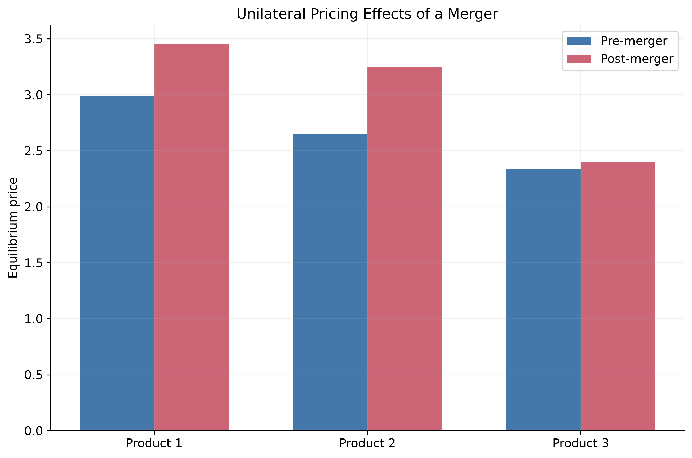
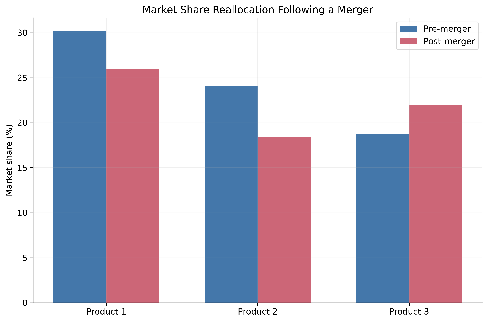
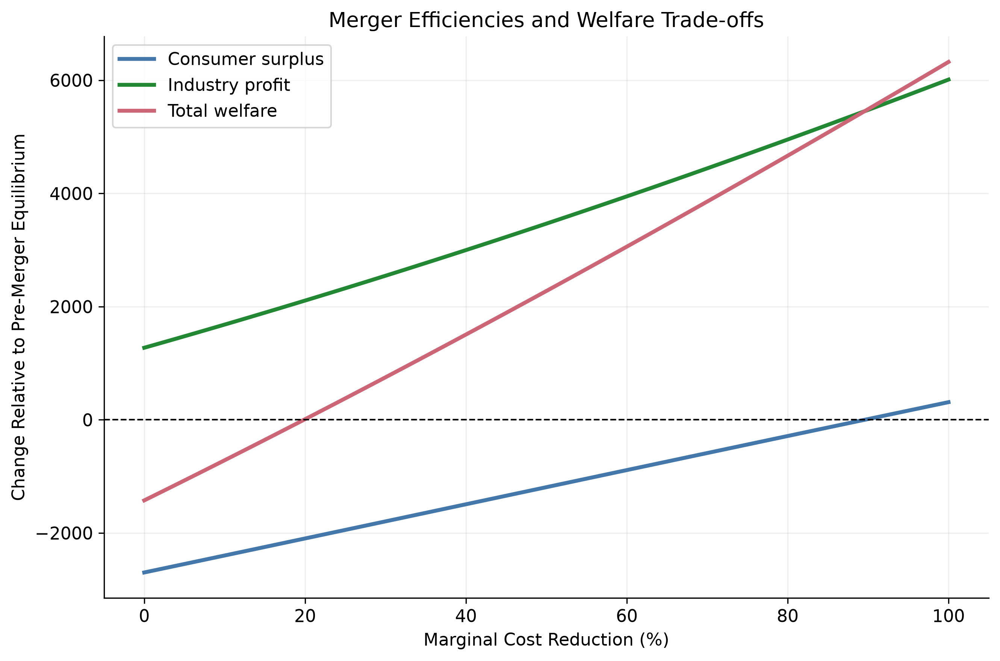

# Competition Economics Toolkit

### Structural Merger Simulation and Welfare Analysis

A computational industrial organisation framework for analysing horizontal mergers, unilateral pricing effects and merger-specific efficiency gains under differentiated Bertrand competition.

## Overview

This project implements a calibrated structural economic model to investigate how changes in market ownership affect equilibrium prices, market shares, firm profitability and consumer welfare.

The framework combines multinomial logit demand with multiproduct Bertrand competition and numerical equilibrium solvers.

## Key Features

- Herfindahl-Hirschman Index and market concentration analysis
- Multinomial logit demand with an outside option
- Own-price and cross-price elasticities
- Demand Jacobian and diversion ratios
- Multiproduct ownership matrices
- Numerical Bertrand equilibrium solver
- Horizontal merger counterfactuals
- Merger-specific marginal cost efficiencies
- Consumer surplus and total welfare analysis
- Welfare break-even efficiency thresholds
- Automated economic and numerical tests
- Interactive Streamlit dashboard

## Illustrative Results

The baseline simulation considers three differentiated 
products, initially supplied by three independent firms.

Following a merger between Firms A and B, without 
marginal cost efficiencies:

| Outcome | Change |
|---|---:|
| Product A price | +15.33% |
| Product B price | +22.74% |
| Product C price | +2.80% |
| Consumer surplus | -16.51% |
| Industry profit | +10.41% |
| Total welfare | -4.98% |

The simulation illustrates how merger-specific efficiencies can generate a divergence between consumer welfare and total welfare assessments.

Under the baseline calibration, total welfare becomes positive at approximately 20% marginal cost efficiency, while consumer surplus remains below its pre-merger level.

## Equilibrium Pricing Effects

## Market Share Reallocation

## Efficiency and Welfare Trade-offs

## Economic Methodology

The model assumes:

- Multinomial logit consumer demand
- Homogeneous price sensitivity
- Differentiated Bertrand price competition
- Constant marginal costs
- Multiproduct profit maximisation
- Full internalisation of pricing externalities within firms
- An outside option with normalised deterministic utility

Equilibrium prices are computed by numerically solving firms' pricing first-order conditions using SciPy.

Merger counterfactuals are constructed by modifying the product ownership matrix and allowing firms to reoptimise their prices.

## Repository Structure

    competition-economics-toolkit/
    ├── src/
    │   ├── concentration.py
    │   ├── demand.py
    │   ├── ownership.py
    │   ├── equilibrium.py
    │   ├── merger_simulation.py
    │   ├── welfare.py
    │   └── visualisation.py
    ├── tests/
    │   └── test_models.py
    ├── results/
    ├── app.py
    ├── requirements.txt
    ├── LICENSE
    └── README.md

## Installation

Clone the repository:

    git clone https://github.com/AnushreeParekh/competition-economics-toolkit.git
    cd competition-economics-toolkit

Create a virtual environment:

    python3 -m venv .venv
    source .venv/bin/activate

Install dependencies:

    python -m pip install -r requirements.txt

## Usage

Run the baseline merger simulation:

    python src/merger_simulation.py

Calculate welfare efficiency thresholds:

    python src/welfare.py

Generate figures and numerical results:

    python src/visualisation.py

Launch the interactive dashboard:

    python -m streamlit run app.py

## Testing

Run the automated test suite:

    python -m pytest -v

The tests examine economic identities, demand derivatives,
ownership structures, equilibrium conditions and selected
merger counterfactuals.

## Limitations and Future Extensions

The model uses synthetic data and calibrated parameters rather than empirically estimated demand.

The multinomial logit specification imposes the independence of irrelevant alternatives property.

Numerical solutions satisfy pricing first-order conditions,but global optimality and equilibrium uniqueness are not independently established.

Potential extensions include:

- Empirical demand estimation
- Random coefficients logit demand
- Nested logit demand
- BLP estimation
- Upward pricing pressure analysis
- Endogenous product entry and exit
- Dynamic competition
- Applications to real-world merger cases

## Technologies

Python | NumPy | SciPy | pandas | Matplotlib | Streamlit | pytest

Research interests: Industrial Organisation, Competition 
Economics, Game Theory, AI Economics and Digital Markets.

